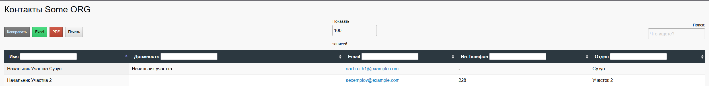

# LDAP-CONTACTS
Этот репозиторий предоставляет простой веб интерфейс с контактной книгой, данные для которой он получает через LDAP.
# Скриншот веб интерфейса

# Установка
1. Положить все файлы в папку /var/www/contacts
2. Файл contacts.apache.conf содержит конфигурацию для apache2, править ее параметры для указания домена, сервера, логина, пароля, OU для поиска и названия компании. Применить конфигурацию.
3. Можно править $valuesToRemove и $replaceMap в index.php для замены или удаления названий OU по пути в котором содержиться учетная запись.

Изначально написано для использования в конкретном окружении MS AD. Аргументы для полей и фильтр можно поменять в файле index.php, вероятнее всего вам прийдется изменить способ получения переменной $UserIpPhone и $filter и возможно  $UserPlace с обработкой $places.
